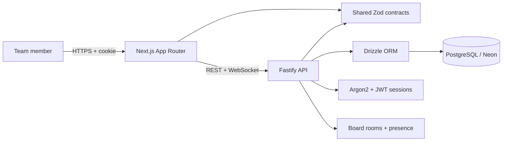
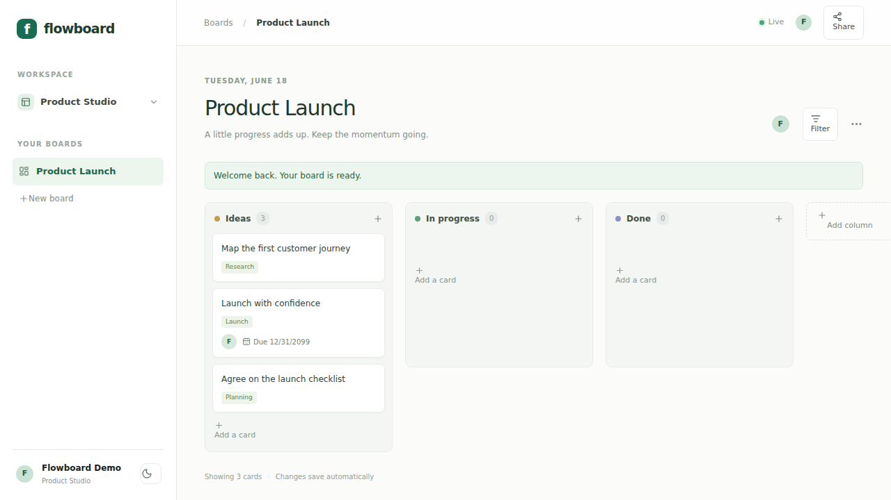
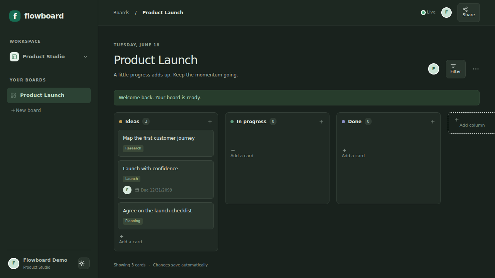
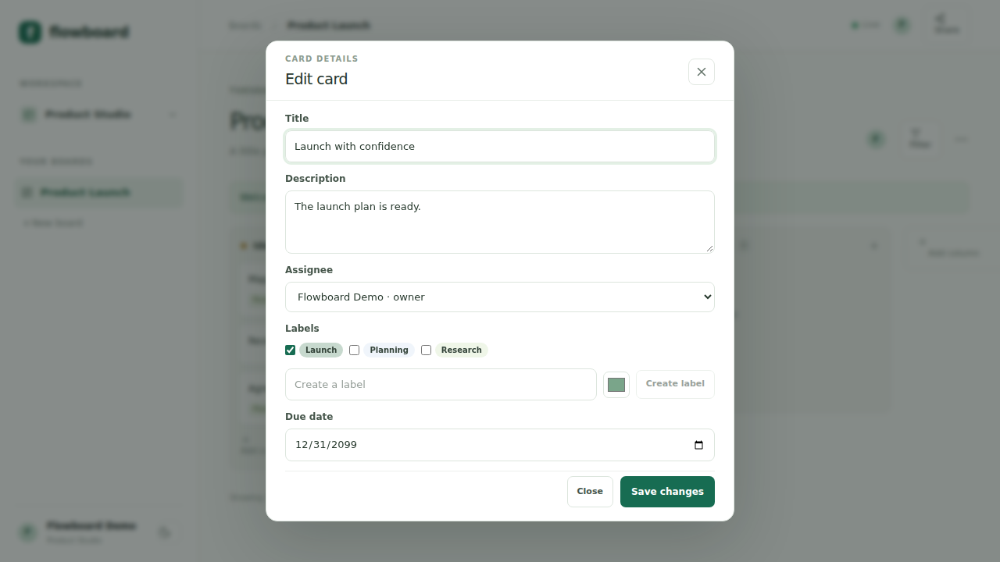

# Flowboard

Flowboard is a real-time collaborative Kanban app built to help small teams keep project work visible without adding process overhead. It is an open-source recruiter showcase focused on practical product engineering: secure sessions, role-aware APIs, persistent ordering, database migrations, realtime updates, and a polished responsive board.

Repository: [github.com/JEHH97/flowboard](https://github.com/JEHH97/flowboard)

## Architecture



## Stack

- **Web:** Next.js App Router, React, TypeScript strict mode, Tailwind CSS, dnd-kit.
- **API:** Fastify, REST, WebSockets, Zod validation, rate limiting, Argon2, JWT cookies.
- **Data:** PostgreSQL, Drizzle ORM, checked-in SQL migration, refresh-token rotation.
- **Quality:** npm workspaces, ESLint, TypeScript project checks, Vitest with V8 coverage, Playwright.

## Technical decisions

- Board roles are checked by the API on every board read, mutation, invitation, and socket join; role checks are also isolated as pure domain logic.
- Fractional numeric order lets a card move without rewriting every sibling position. A rebalance helper is available when a gap is exhausted.
- Short-lived access cookies and hashed, revocable refresh sessions keep tokens out of browser storage. Cookies are HttpOnly and production cookies require TLS.
- REST requests and realtime messages share the same board identifier. The server verifies membership before attaching a socket to a room and broadcasts mutations to peers.
- Zod schemas live in a shared workspace, so browser and server use the same request contract.

## Local run

Prerequisites: Docker Compose and Node.js 24 or newer. Copy `.env.example` to `.env` only if you want to customize the local defaults. One command starts PostgreSQL, applies migrations, seeds the demo workspace, and starts the web and API services:

```sh
docker compose up --build
```

Open [http://localhost:3001](http://localhost:3001). The demo account is `demo@flowboard.dev` with password `flowboard-demo-password` (local showcase credential only; replace it for any shared environment). The API health check is at [http://localhost:4000/health](http://localhost:4000/health).

Stop and remove local services and database data with `docker compose down -v`.

## Tests and checks

```sh
scripts/in-dev npm ci
scripts/in-dev npm run check
```

`check` runs the restricted-content scan, lint, typecheck, unit and database integration tests with domain coverage thresholds, then production builds. To exercise browser flows while the Compose stack is running:

```sh
scripts/in-dev npx playwright install chromium
scripts/in-dev npm run e2e
```

With Compose running, copy `.env.example` to `.env`, then load it before `scripts/in-dev npm run check` to include the Postgres-backed integration suite:

```sh
cp .env.example .env
set -a && . ./.env && set +a
scripts/in-dev npm run check
```

CI supplies its own Postgres service container. The E2E flow signs in in two browser contexts, creates a card, checks that the other client receives the update, and saves light/dark board screenshots in `docs/`.

## Screenshots







## Demo

Live demo: **[Add hosted demo URL]**. The project is configured for a Vercel web deployment, a Render API service, and a Neon PostgreSQL database; see [DEPLOY.md](DEPLOY.md).

## Repository map

```text
apps/api       Fastify service, schema, migration, seed and API tests
apps/web       Next.js app and browser tests
packages/shared Shared validation contracts and domain rules
docs           Captured board screenshots
```

## License

MIT. See [LICENSE](LICENSE).
